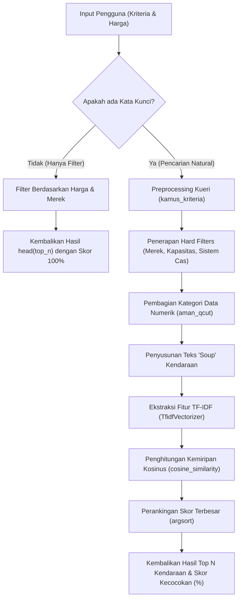

# Panduan Penyusunan Skripsi: BAB IV - Implementasi dan Pengujian
**Sistem Rekomendasi Kendaraan Listrik Berbasis TF-IDF dan Cosine Similarity**

Dokumen ini disusun khusus untuk membantu Anda merangkum seluruh aspek teknis dari kode sumber proyek **Sistem Rekomendasi Kendaraan Listrik** ke dalam format tulisan akademis (Skripsi/Tugas Akhir). Dokumen ini mengacu langsung pada file-file utama di codebase Anda.

---

## 📊 Diagram Alir Sistem (Rekomendasi Engine)
Untuk memudahkan penulisan dan pemahaman penguji/dosen pembimbing, berikut adalah visualisasi proses rekomendasi yang diimplementasikan di [ml_engine.py](file:///d:/SEMESTER%208/TUGAS%20AKHIR/Sistem%20Rekomendasi%20Kendaraan%20Listrik/rekomendasi/ml_engine.py):

---

## 📑 Struktur Isi BAB IV: Implementasi dan Pengujian

Berikut adalah rancangan sub-bab yang dapat Anda gunakan, lengkap dengan penjelasan detail apa saja yang harus Anda tulis di masing-masing bagian berdasarkan kode nyata Anda:

### 4.1 Implementasi Sistem
Bagian ini menjelaskan bagaimana hasil rancangan (desain) diterjemahkan ke dalam kode program yang siap dijalankan.

#### 4.1.1 Implementasi Lingkungan (Spesifikasi Hardware & Software)
Tuliskan spesifikasi teknologi yang Anda gunakan untuk membangun dan menjalankan aplikasi ini:
*   **Perangkat Lunak (Software):**
    *   Sistem Operasi: Windows 10/11.
    *   Bahasa Pemrograman: Python 3.x.
    *   Web Framework: Django 4.x / 5.x.
    *   Pustaka Analisis & ML: `pandas`, `scikit-learn` (`TfidfVectorizer`, `cosine_similarity`).
    *   Pustaka Pemrosesan Gambar: `Pillow (PIL)` (digunakan untuk kompresi WebP otomatis).
    *   Database: SQLite / MySQL.
*   **Perangkat Keras (Hardware):** (Tuliskan spesifikasi laptop/komputer yang Anda gunakan, misal RAM, Prosesor, SSD).

#### 4.1.2 Implementasi Basis Data (Database)
Jelaskan struktur tabel basis data yang dibuat melalui ORM (Object-Relational Mapping) Django di file [models.py](file:///d:/SEMESTER%208/TUGAS%20AKHIR/Sistem%20Rekomendasi%20Kendaraan%20Listrik/rekomendasi/models.py). Anda memiliki beberapa model utama:
1.  **[BaseKendaraan](file:///d:/SEMESTER%208/TUGAS%20AKHIR/Sistem%20Rekomendasi%20Kendaraan%20Listrik/rekomendasi/models.py#L15) (Abstract Class):** 
    *   Menampung atribut umum kendaraan: `merek`, `harga`, `jarak_tempuh`, `kapasitas_baterai`, `gambar`.
    *   **Poin Unggulan Akademis (Optimasi Gambar):** Jelaskan bahwa sistem mengimplementasikan penanganan gambar otomatis dalam metode `save()` yang mengubah seluruh gambar terunggah menjadi format `.webp` berkualitas 85% untuk mempercepat pemuatan halaman (*client-side optimization*).
2.  **[Mobil](file:///d:/SEMESTER%208/TUGAS%20AKHIR/Sistem%20Rekomendasi%20Kendaraan%20Listrik/rekomendasi/models.py#L52) (Roda 4):**
    *   Mewarisi `BaseKendaraan` ditambah field spesifik: `kapasitas_penumpang`, `tipe_kendaraan` (SUV, MPV, Hatchback), `fitur_keselamatan`, `garansi`, `jaringan_servis`.
3.  **[FotoInteriorMobil](file:///d:/SEMESTER%208/TUGAS%20AKHIR/Sistem%20Rekomendasi%20Kendaraan%20Listrik/rekomendasi/models.py#L63):**
    *   Relasi `ForeignKey` (Many-to-One) dengan `Mobil` untuk mendukung fitur galeri foto interior (carousel) pada halaman detail mobil.
4.  **[Motor](file:///d:/SEMESTER%208/TUGAS%20AKHIR/Sistem%20Rekomendasi%20Kendaraan%20Listrik/rekomendasi/models.py#L85) (Roda 2):**
    *   Mewarisi `BaseKendaraan` ditambah field spesifik: `kecepatan_maksimum`, `waktu_pengisian`, `jumlah_baterai`, `sistem_pengisian` (pilihan: Direct Charging, Swap Baterai, Keduanya).

> [!TIP]
> Tampilkan skema relasi antar-tabel (ERD) atau tabel kamus data (Data Dictionary) untuk masing-masing model di atas di laporan Anda untuk memperkuat dokumentasi basis data.

#### 4.1.3 Implementasi Algoritma dan Mesin Rekomendasi
Ini adalah jantung dari Bab IV Anda. Jelaskan alur kerja dari mesin rekomendasi di file [ml_engine.py](file:///d:/SEMESTER%208/TUGAS%20AKHIR/Sistem%20Rekomendasi%20Kendaraan%20Listrik/rekomendasi/ml_engine.py). Bahas komponen-komponen berikut:

*   **Pembersihan & Pemetaan Kueri (`kamus_kriteria`):**
    Bagaimana sistem menerjemahkan bahasa alami pengguna ke istilah sistem (misal: kata "murah" atau "ekonomis" diubah menjadi token `"harga_terjangkau"`).
*   **Penapisan Keras (*Hard Filters*):**
    Sebelum menghitung kemiripan kosinus, sistem melakukan *pre-filtering* jika pengguna menyebutkan nama merek tertentu secara eksplisit, kapasitas penumpang tertentu (misal "7 penumpang"), atau metode pengisian daya motor ("swap baterai"). Hal ini mempercepat pencarian dan menjamin keakuratan.
*   **Metode Kategorisasi Kuantil (`aman_qcut`):**
    Bagaimana data numerik kontinu (seperti harga kendaraan) dibagi menjadi kategori diskret secara dinamis berbasis persentase kuantil data menggunakan Pandas `pd.qcut` agar bisa dicocokkan dengan teks kueri pengguna.
*   **Penyusunan Teks *Soup* Kendaraan:**
    Proses penggabungan semua atribut tekstual dan kategori numerik menjadi satu string panjang (Metadata Soup) untuk setiap baris kendaraan di DataFrame (misalnya: `harga_terjangkau jarak_jauh baterai_besar penumpang_5 suv airbag abs...`).
*   **Ekstraksi Fitur TF-IDF & Cosine Similarity:**
    Penggunaan `TfidfVectorizer` dari Scikit-Learn untuk menghitung bobot kata di dalam *soup* dan kueri pengguna, dilanjutkan dengan fungsi `cosine_similarity` untuk mencari sudut kedekatan vektor antara kueri pengguna dan spesifikasi kendaraan.

#### 4.1.4 Implementasi Kontroler (Views) & Import CSV
Jelaskan alur kendali aplikasi di file [views.py](file:///d:/SEMESTER%208/TUGAS%20AKHIR/Sistem%20Rekomendasi%20Kendaraan%20Listrik/rekomendasi/views.py):
*   **[halaman_rekomendasi](file:///d:/SEMESTER%208/TUGAS%20AKHIR/Sistem%20Rekomendasi%20Kendaraan%20Listrik/rekomendasi/views.py#L7):** Mengambil parameter pencarian berbasis GET dari frontend (`kriteria`, `jenis`, `min_harga`, `max_harga`), memanggil mesin rekomendasi yang sesuai, lalu mengirimkan hasil beserta list opsi filter dinamis (seperti merek terdaftar, tipe mobil, sistem pengisian motor) ke halaman utama.
*   **[dashboard_admin](file:///d:/SEMESTER%208/TUGAS%20AKHIR/Sistem%20Rekomendasi%20Kendaraan%20Listrik/rekomendasi/views.py#L104) (Fungsi Upload CSV):**
    Bagian yang sangat penting untuk dibahas secara akademis. Jelaskan proses ETL (Extract, Transform, Load) saat Admin mengunggah file data massal `.csv`. Tunjukkan bagaimana data kotor dibersihkan menggunakan Pandas:
    *   Pembersihan string unit (menghapus satuan seperti "km", "kwh", "km/jam", tanda koma).
    *   Konversi tipe data dari teks ke float/integer secara aman dengan penanganan *exception* `ValueError`.
    *   Penanganan sel kosong (`fillna('')`) untuk mencegah terjadinya kegagalan pemrosesan (*crash*).

#### 4.1.5 Implementasi Antarmuka (User Interface)
Tampilkan tangkapan layar (Screenshot) halaman-halaman aplikasi beserta fungsi masing-masing komponen estetika premium Anda:
1.  **Halaman Beranda / Dashboard Utama ([beranda.html](file:///d:/SEMESTER%208/TUGAS%20AKHIR/Sistem%20Rekomendasi%20Kendaraan%20Listrik/templates/rekomendasi_app/beranda.html)):**
    *   Tunjukkan bagian form input pencarian natural (kriteria) dan filter visual (grid kategori/merek, filter harga slider, preferensi teknis Roda 4/Roda 2).
    *   Tunjukkan kartu hasil rekomendasi yang menampilkan **Skor Kecocokan (Match Score %)** yang dihitung secara *real-time* oleh algoritma Cosine Similarity.
2.  **Halaman Detail Kendaraan ([detail.html](file:///d:/SEMESTER%208/TUGAS%20AKHIR/Sistem%20Rekomendasi%20Kendaraan%20Listrik/templates/rekomendasi_app/detail.html)):**
    *   Tunjukkan visualisasi data teknis spesifikasi kendaraan.
    *   Bahas fitur carousel foto interior interaktif khusus untuk Mobil (R roda 4) yang terhubung ke model `FotoInteriorMobil`.
3.  **Halaman Administrator Dashboard (`dashboard.html`):**
    *   Tunjukkan antarmuka pengunggahan CSV, statistik jumlah kendaraan, tabel daftar kendaraan, serta tombol untuk CRUD (Create, Read, Update, Delete) secara visual.

---

### 4.2 Pengujian Sistem
Bagian ini memaparkan hasil pengujian untuk memastikan kelayakan sistem baik dari sisi fungsionalitas aplikasi maupun akurasi hasil rekomendasi.

#### 4.2.1 Pengujian Fungsional (Black-box Testing)
Gunakan pengujian *Black-box* untuk menguji seluruh fungsionalitas UI. Buatlah tabel pengujian seperti berikut di laporan Anda:

| No | Skenario Pengujian | Butir Uji / Langkah | Hasil yang Diharapkan | Status |
|----|--------------------|---------------------|-----------------------|--------|
| 1  | Memilih Jenis Kendaraan | Memilih radio button "Mobil" / "Motor" | Formulir filter preferensi teknis berubah secara dinamis sesuai jenis kendaraan yang dipilih | Sukses |
| 2  | Pencarian Tanpa Kriteria | Menekan tombol "Cari Rekomendasi" dengan kolom kriteria kosong | Sistem menampilkan daftar kendaraan berdasarkan filter harga/merek dengan skor kecocokan default 100% | Sukses |
| 3  | Pencarian dengan Kriteria Bahasa Alami | Mengetik kriteria "mobil listrik SUV murah dengan airbag dan abs" | Sistem memfilter mobil tipe SUV, melakukan pembobotan kata kunci, dan menampilkan peringkat mobil dengan skor kecocokan tertinggi | Sukses |
| 4  | Unggah Data CSV Massal | Admin mengunggah file CSV data mobil dengan sel kosong atau satuan teks | Sistem sukses memproses, membersihkan string satuan, melakukan *type casting*, dan menyimpan data ke database tanpa error | Sukses |
| 5  | Upload Foto Interior Mobil | Admin mengunggah beberapa gambar interior untuk satu mobil | Gambar interior berhasil disimpan dan ditampilkan sebagai carousel interaktif di halaman detail mobil | Sukses |

#### 4.2.2 Pengujian Algoritma & Validasi Rekomendasi
Untuk meyakinkan dosen penguji mengenai kualitas algoritma TF-IDF dan Cosine Similarity, buatlah pengujian kasus simulasi kueri dan tunjukkan kecocokan hasilnya secara matematis dan sistematis.

**Kasus Uji 1: Kueri Pencarian Motor Listrik**
*   **Kueri Pengguna:** *"motor murah jarak jauh swap baterai"*
*   **Langkah Analisis Algoritma:**
    1.  *Hard Filter* menyaring motor yang memiliki metode pengisian `Swap Baterai` or `Keduanya` di database.
    2.  *Query Preprocessing* menerjemahkan "murah" $\rightarrow$ `harga_terjangkau` dan "jarak jauh" $\rightarrow$ `jarak_jauh`.
    3.  *Soup* setiap motor yang lolos filter disusun (misal: `harga_terjangkau jarak_jauh kecepatan_standar cas_cepat baterai_2 sistem_swap_baterai`).
    4.  Hasil perhitungan `cosine_similarity` menghasilkan skor kecocokan tertinggi pada motor yang memang memiliki kategori harga murah dan jarak tempuh terjauh.
*   **Tabel Hasil Uji Kasus 1:**
    Tampilkan tabel 5 motor teratas hasil rekomendasi dari kueri tersebut lengkap dengan kolom: Merek, Harga Nyata, Jarak Tempuh, Sistem Pengisian, dan **Skor Kecocokan (%)**. Tunjukkan bahwa motor dengan spesifikasi yang paling pas menempati peringkat 1.

**Kasus Uji 2: Kueri Pencarian Mobil Listrik**
*   **Kueri Pengguna:** *"mobil mewah tipe suv dengan airbag dan garansi panjang"*
*   **Langkah Analisis Algoritma:**
    1.  *Query Preprocessing* menerjemahkan "mewah" $\rightarrow$ `harga_premium` dan "garansi panjang" $\rightarrow$ `garansi_panjang`.
    2.  *Hard Filter* menyaring mobil dengan tipe kendaraan `SUV`.
    3.  *Vector Similarity* menghitung kedekatan istilah "harga_premium", "suv", "airbag", "garansi_panjang" terhadap seluruh data mobil tipe SUV di database.
*   **Tabel Hasil Uji Kasus 2:**
    Tampilkan tabel 5 mobil teratas hasil kueri ini beserta spesifikasi kunci dan persentase skor kecocokannya.

---

💡 **Saran Tambahan untuk Sidang/Skripsi:**
*   **Sertakan Potongan Kode Penting:** Jangan ragu untuk memasukkan potongan kode algoritma dari [ml_engine.py](file:///d:/SEMESTER%208/TUGAS%20AKHIR/Sistem%20Rekomendasi%20Kendaraan%20Listrik/rekomendasi/ml_engine.py) (khususnya fungsi `get_rekomendasi_mobil` atau pemrosesan `soup`) ke dalam laporan Anda, lalu jelaskan baris demi baris menggunakan bahasa Indonesia yang baik. Ini akan menambah nilai akademis skripsi Anda!
*   **Tekankan Efisiensi WebP:** Masukkan bagian konversi gambar WebP di [models.py](file:///d:/SEMESTER%208/TUGAS%20AKHIR/Sistem%20Rekomendasi%20Kendaraan%20Listrik/rekomendasi/models.py) ke dalam bab implementasi karena ini membuktikan bahwa Anda tidak hanya membuat sistem rekomendasi, tetapi juga memikirkan performa dan efisiensi penyimpanan server.
